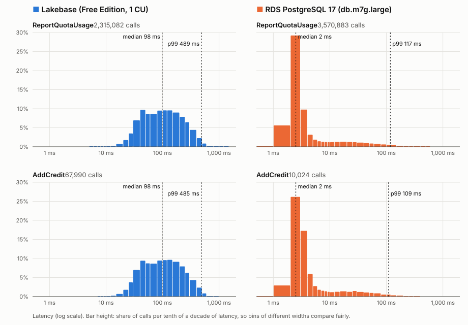
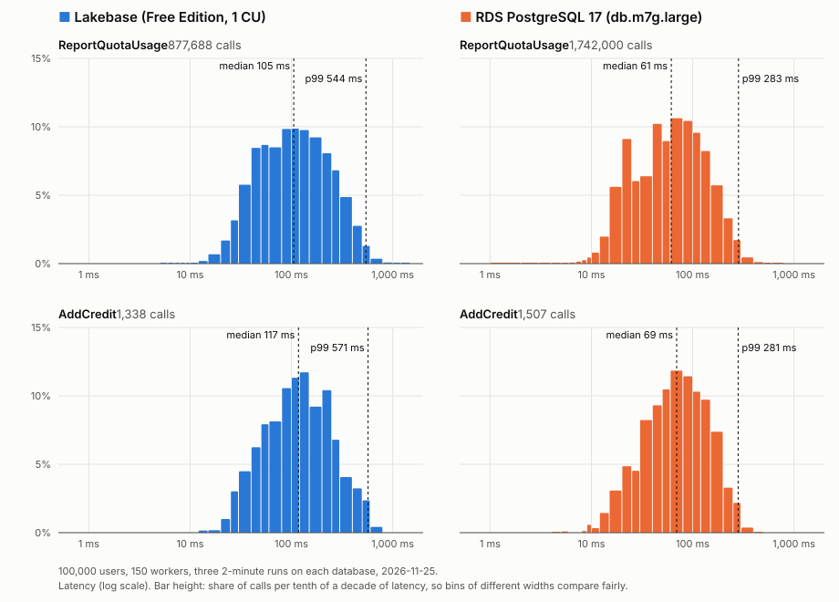
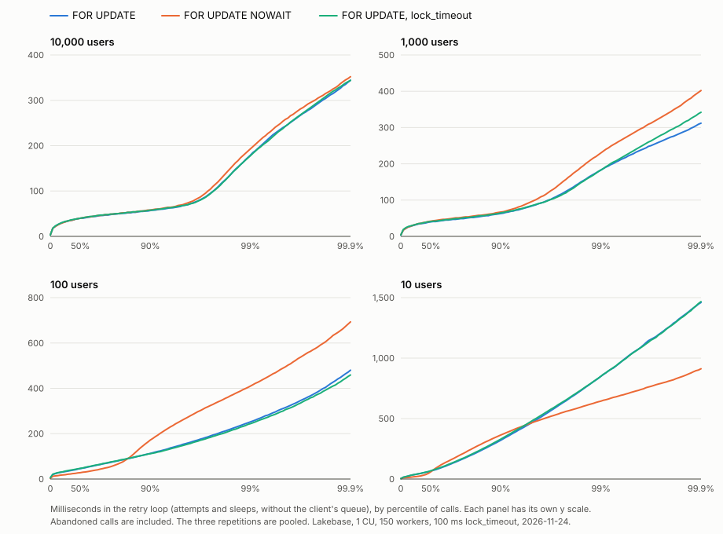

# lakebase-charglt
Databricks Lakebase implementation of [Charglt](https://github.com/srmadscience/voltdb-charglt), derived from
[postgres-charglt](https://github.com/srmadscience/postgres-charglt).

It has the same basic functionality as charglt, adapted for PostgreSQL and Databricks Lakebase — see TODO for known gaps.
Transactions are exported to a Delta table by a Databricks job, and approved credits are applied back from Databricks.

Far more documentation about the benchmark itself is available at the link above.

## See Also:

* [aerospike-charglt](https://github.com/srmadscience/aerospike-charglt)
* [mongodb-charglt](https://github.com/srmadscience/mongodb-charglt)
* [oracle-charglt](https://github.com/srmadscience/oracle-charglt)
* [postgres-charglt](https://github.com/srmadscience/postgres-charglt)
* [redis-charglt](https://github.com/srmadscience/redis-charglt)
* [s2-charglt](https://github.com/srmadscience/s2-charglt)
* [voltdb-charglt](https://github.com/srmadscience/voltdb-charglt)

## Prerequisites

* PostgreSQL 12 or later (generated column support required)
* Java 21
* Maven

## Installation

1. Create the database:
```sql
CREATE DATABASE charglt;
```

2. Connect to the `charglt` database and run the schema DDL:
```
psql -d charglt -f ddl/create_db.sql
```

3. Run the stored functions DDL:
```
psql -d charglt -f ddl/create_procs.sql
```


## Configuration

Connection details are set via environment variables:

| Variable | Default (fallback) | Description |
|---|---|---|
| `PG_HOST` | first CLI argument | PostgreSQL host (single host or comma-separated list for failover) |
| `PG_USER` | CLI argument | Database user |
| `PG_PASSWORD` | CLI argument | Database password |
| `PG_PORT` | `5432` | Port |
| `PG_DATABASE` | `charglt` | Database name |
| `PG_SSLMODE` | driver default | JDBC `sslmode`, e.g. `require` |

## Databricks Lakebase

The benchmark runs unchanged on a Databricks Lakebase Autoscaling project. `lakebase-env.sh` looks up the endpoint's
host, generates a one-hour OAuth token to use as the password, and exports the `PG_*` variables (and `PGHOST` etc.
for `psql`):

```
. ./lakebase-env.sh path/to/databricks.properties   # needs databricks.host and databricks.token
psql -d databricks_postgres -c 'CREATE DATABASE charglt'
psql -d charglt -f ddl/create_db.sql
psql -d charglt -f ddl/create_procs.sql
```

`LAKEBASE_PROJECT` (default `charglt`), `LAKEBASE_BRANCH` (default `production`) and `LAKEBASE_ENDPOINT`
(default `primary`) select the endpoint. The hostname, username and password CLI arguments are then ignored.
Re-source the script before each run: new logins need an unexpired token.

### Exporting transactions to Delta

Every successful `UpsertUser`, `ReportQuotaUsage` and `AddCredit` calls `SendToKafka` (named after the VoltDB
original's Kafka export), which copies the new `user_recent_transactions` row into the `charglt_events` table.
A serverless Databricks job, `charglt-export`, moves those rows into the Delta table
`workspace.charglt.transactions` every 5 minutes. It locks a batch of up to 50,000 rows in Lakebase, merges it into
Delta, then deletes it from Lakebase in the same Postgres transaction, so a failed run is simply redone by the next
one. The job logs in to Lakebase the same way `lakebase-env.sh` does, as the job owner.

```
./databricks-sql.sh -f databricks/create_tables.sql   # create workspace.charglt.transactions
./databricks-job.sh --run            # upload databricks/charglt_export.py, create the job, run it once
./databricks-job.sh --start on       # export every 5 minutes (--start off to pause)
./databricks-sql.sh -f databricks/charglt_views.sql
./databricks-sql.sh 'SELECT * FROM export_lag'
```

The schedule starts paused: on Free Edition each run counts against the daily compute quota, so turn it on for a
benchmark run and off afterwards. `databricks-sql.sh` runs SQL on the Serverless Starter Warehouse
(`8682c92f3ae0c2a8`; set `DATABRICKS_WAREHOUSE_ID` to use another). To discard a backlog without exporting it, run
`SELECT PurgeChargltEvents(INTERVAL '1 hour')`.

### Querying Lakebase tables from Databricks

Registering the Lakebase database in Unity Catalog makes its tables and views appear in Databricks as a read-only
catalog, with no job and no copy to look after. This worked on Free Edition on 2026-11-25:

```
curl -X POST "https://$DATABRICKS_HOST/api/2.0/postgres/catalogs?catalog_id=charglt_lakebase" \
  -H "Authorization: Bearer $DATABRICKS_TOKEN" -H 'Content-Type: application/json' \
  -d '{"spec": {"postgres_database": "charglt", "branch": "projects/charglt/branches/production"}}'
./databricks-sql.sh 'SELECT count(*), sum(user_balance) FROM charglt_lakebase.public.user_table'
```

Here `DATABRICKS_HOST` is the workspace's hostname, without `https://`. Queries need a serverless warehouse or other
serverless compute. In testing, an insert, an update and a delete in Postgres each showed up in the next query, and a
`DELETE` from Databricks was refused. `JSONB` columns appear as strings. New tables can take a while to appear.

- It shows what is in Postgres now and keeps no history. `user_recent_transactions` keeps each user's rows for about a
  second, so `charglt-export` is still needed to keep transactions and to stay under the storage limit.
- Queries probably use the Lakebase endpoint's own compute, though this was not measured. Avoid them during a benchmark.

To unregister it, send `DELETE` to `/api/2.0/postgres/catalogs/charglt_lakebase`. Databricks says this doesn't affect
the Postgres database.

Lakebase Change Data Feed was not used: it produces a history of changes rather than the table, and it can't write
to a catalog on default storage, such as the one that Free Edition provides.

### Applying approved credits from Databricks

Credits can also flow the other way. Rows inserted into the Delta table `workspace.charglt.approved_addcredits`
(created by `databricks/create_tables.sql`) are applied in Lakebase with `AddCredit` by the `charglt-apply-credits`
job, which a table-update trigger starts when that table changes:

```
./databricks-job.sh apply-credits --start on     # enable the trigger (--start off to pause; --run to run once)
./databricks-sql.sh 'INSERT INTO approved_addcredits (userid, add_credit_value) VALUES (42, 100)'
./databricks-sql.sh 'SELECT * FROM approved_addcredits_status ORDER BY request_id DESC LIMIT 10'
```

The trigger waits until the table has been quiet for 60 seconds and starts at most one run a minute; in testing a
run started about a minute after an insert. Changes made in the first minute or so after the trigger is enabled can
be missed; they are picked up by the next run (each run applies everything pending), or use `--run`. Watching the
table costs nothing; only the runs use compute. The job only reads `approved_addcredits` and writes outcomes to
`approved_addcredit_results`, so its own writes don't start another run. The `approved_addcredits_status` view
joins the two; a request with no `applied_at` has not been applied yet.

Each request gets a `request_id`. The job sends up to 1,000 unapplied requests per call to
`ApplyApprovedAddCredits`, which runs in one Postgres transaction: for each request it records `request_id` in
`approved_addcredit_log` and calls `AddCredit`, so the credits and the log commit or roll back together. A
`request_id` already in the log is not applied again, so a batch resent after a failure (for example, if the job
stops after Postgres commits but before Delta is updated) changes nothing. The job then writes each request's
`status_byte`, `status_string` and `applied_at` to `approved_addcredit_results`: 56 means added, 50 means the user
does not exist. Requests that fail are not retried. A request whose user is locked by another transaction hasn't
failed: `ApplyApprovedAddCredits` skips it without logging it, the rest of the batch is applied, and the job sends it
again a second later. If only locked users are left for 30 tries in a row, the job run fails and leaves those
requests pending; use `--run` to try again, as the trigger only fires when the table changes.

`AddCredit`'s own duplicate check only covers about a second (`user_recent_transactions` is aged out), which is why
the log is needed. Don't recreate `approved_addcredits` without also clearing `approved_addcredit_log` and
`approved_addcredit_results`: its `request_id` would restart at 1, and `ApplyApprovedAddCredits` rejects a known
`request_id` with a different user or amount.

Every call is a network round trip, so when running far from the endpoint use plenty of loader threads and
benchmark workers.

### Example results

> **Disclaimer:** these numbers come from a smoke test, run only to show that the benchmark works on Lakebase.
> They are not a performance benchmark, and should not be quoted or used to compare Lakebase with other databases.

These runs used a Free Edition workspace (Postgres 17, 1 CU, AWS us-east-2), with the client on a Mac about
130 ms away (round-trip time). They show the benchmark working, not what Lakebase can do: throughput is limited by
round trips, and grows almost in step with the number of workers.

Loading 10,000 users (`CreateChargingDemoData`):

| Threads | Users per second |
|---|---|
| 1 | ~4 |
| 16 | 58 |

`ChargingDemoTransactions` with 10,000 users, 60 seconds, and 2 tpms requested (so it reports
`UNABLE_TO_MEET_REQUESTED_TPS`):

| Workers | Transactions | TPS | ReportQuotaUsage median / p99 (ms) | AddCredit median / p99 (ms) |
|---|---|---|---|---|
| 16 | 6,018 | 99 | 588 / 1,703 | 571 / 1,691 |
| 100 | 34,698 | 569 | 428 / 1,683 | 417 / 1,658 |
| 150 | 50,998 | 836 | 421 / 1,634 | 404 / 1,614 |
| 200 | 71,544 | 1,173 | 445 / 1,616 | 443 / 1,674 |

Latencies are measured at the client and include time waiting in the client's queue (a median of 443 ms with
16 workers and 279 ms with 100).

Throughput stays at about 5.7 TPS per worker from 100 to 200 workers, and median latency does not rise, so the
1 CU endpoint is not saturated: the round trip is the limit. The endpoint allows 225 connections (7 reserved for
superusers), so about 200 workers is as far as this client can go. See *From a client in the same region* below
for a run without the round trip.

`ChargingDemoTransactions` with 200 workers for 30 minutes:

| Workers | Duration | Transactions | TPS | ReportQuotaUsage median / p99 (ms) | AddCredit median / p99 (ms) |
|---|---|---|---|---|---|
| 200 | 30 min | 2,063,974 | 1,146 | 422 / 1,574 | 420 / 1,574 |

Averaged over 30 minutes, throughput and latency are close to the 60-second run with 200 workers.

A 15-minute run (900 seconds) with 150 workers held the rate of the 60-second run with 150 workers. Opening the
150 connections took a further 2.5 minutes, which isn't included in the timing:

| Transactions | TPS | ReportQuotaUsage median / p95 / p99 (ms) | AddCredit median / p95 / p99 (ms) |
|---|---|---|---|
| 755,669 | 834 | 441 / 1,240 / 1,665 | 444 / 1,232 / 1,652 |

The run wrote 722,794 events to `charglt_events`. With `charglt-export` on its 5-minute schedule, one run exported
617,669 of them to Delta in 93 seconds and the next run exported the rest.

#### With the export job running

`ChargingDemoTransactions` with 10,000 users, 60 seconds, 2 tpms and 16 workers, after `SendToKafka` started writing
to `charglt_events`, with the `charglt-export` job on its 5-minute schedule (same workspace and client as above):

| Workers | Transactions | TPS | ReportQuotaUsage median / p99 (ms) | AddCredit median / p99 (ms) |
|---|---|---|---|---|
| 16 | 6,213 | 102 | 693 / 1,702 | 786 / 1,711 |

Throughput matches the earlier 16-worker run (99 TPS). Medians are higher, but so is the time spent waiting in the
client's queue (554 ms against 443 ms), and there were only 41 AddCredit calls, so a 60-second run can't separate the
cost of the extra insert from run-to-run variation.

The export kept up. A scheduled run fired during the benchmark and exported 2,830 rows while transactions were
still arriving; the next exported the remaining 3,329 in 26 seconds. `workspace.charglt.transactions` ended with
6,159 rows (6,118 Spend, 41 Add Credit), the same as the benchmark's ReportQuotaUsage and AddCredit counts, with no
duplicates and nothing left in `charglt_events`.

#### From a client in the same region

> **Disclaimer:** also a smoke test, not a benchmark. The Lakebase and RDS setups below are not sized to match,
> so they compare these two configurations, not the products.

The same 15-minute run (10,000 users, 150 workers, 2 tpms requested) from an EC2 c7g.xlarge (4 vCPU, Amazon Linux
2023, Java 21) in us-east-2c, against the same Lakebase endpoint and against RDS for PostgreSQL 17.11 on a
db.m7g.large (2 vCPU, 8 GB, gp3) in the same zone:

| Database | Transactions | TPS | ReportQuotaUsage median / p95 / p99 (ms) | AddCredit median / p95 / p99 (ms) |
|---|---|---|---|---|
| Lakebase, 1 CU | 2,470,681 | 2,745 | 98 / 354 / 489 | 98 / 354 / 485 |
| RDS PostgreSQL 17 | 3,591,724 | 3,991 | 2 / 35 / 117 | 2 / 36 / 109 |



Without the 130 ms round trip, Lakebase ran at 3.3 times the rate from the Mac, and opening the 150 connections
took 5 seconds instead of 2.5 minutes. A TCP connect to the Lakebase endpoint took under 10 ms.

- **Client limit:** 3,991 TPS is the most the client would send, not the most RDS could do. With `tpms` set to 2 the
  client sends 4 calls per millisecond rather than 2. In this run it was held up by full queues for only 2 of the 900
  seconds and sent 4,000 calls a second the rest of the time, so the RDS latencies are for a server that was
  not saturated. The gap between the two databases is understated here: see *100,000 users* below.
- **Storage limit:** Free Edition caps a Lakebase instance at 512 MB. A first run from EC2, with the export job
  paused, failed after 14 minutes at about 2,770 TPS, when `charglt_events` reached 2.3 million rows and
  transactions began failing with `could not extend file because instance size limit (512 MB) has been exceeded`. With
  `charglt-export` on its 5-minute schedule, the rerun above kept the database near 200 MB and finished cleanly. At
  these rates, keep the export job running.
- **Initial credit:** the RDS users were loaded with `CreateChargingDemoData` and a maximum initial credit of
  100,000 (4,757 users per second with 32 threads). The Lakebase users came from an earlier load whose credit
  setting wasn't recorded, which is why Lakebase made 67,990 AddCredit calls against 10,024 on RDS.
- **Events:** on RDS, `charglt_events` was never exported and grew by 3.6 million rows during the run.

The redacted logs, the per-millisecond histograms (`results/2026-11-18-latency-histograms.csv`) and the scripts
that extract and draw them are in `results/`.

#### 100,000 users

> **Disclaimer:** as above, this compares two configurations that are not sized to match, not the products.

Run on 2026-11-25 from a c7g.xlarge in us-east-2c, with 100,000 users, 150 workers and 2-minute runs. `tpms` was 20, so
that the client's rate limit didn't decide the result (see *Client limit* above). The users were loaded with a maximum
initial credit of 100,000. The functions used `FOR UPDATE NOWAIT`, and calls for one user never overlapped, so no call
found its row locked. Three runs on each database, in the order Lakebase, RDS, RDS, Lakebase, Lakebase, RDS:

| Database | TPS by run | Mean TPS | ReportQuotaUsage median / p95 / p99 (ms) | Time in retry loop, mean / median / p95 / p99 (ms) | Users loaded per second (32 threads) |
|---|---|---|---|---|---|
| Lakebase, 1 CU | 2,439, 2,452, 2,413 | 2,435 | 105 / 382 / 544 | 43.9 / 38 / 80 / 226 | 3,323 |
| RDS PostgreSQL 17.11, db.m7g.large (2 vCPU) | 4,817, 4,902, 4,789 | 4,836 | 61 / 202 / 283 | 23.4 / 22 / 40 / 57 | 6,907 |



Percentiles in the table are averaged over the three runs; the graph pools them. `ReportQuotaUsage` includes time in the client's queue; the retry loop
doesn't. TPS here counts only calls that were carried out.

- **RDS used all of its CPU:** up to 99% on 2 vCPUs, so about 4,800 TPS is near its limit for this workload, and
  its latencies include waiting for CPU. There are no CPU figures for Lakebase; no sessions were seen waiting on I/O.
- **The client may still limit throughput:** its one generator thread was held up by full queues for 98 to 109 of each 120
  seconds, while on average 106 to 114 of the 150 workers were busy. How much this costs was not tested.

Logs, session samples, client CPU samples and the per-millisecond histograms are in `results/2026-11-25-100k-users/`.

#### Many calls for the same user at once

> **Note:** these runs predate `NOWAIT`. They used a plain `SELECT ... FOR UPDATE`, so a call for a locked user
> waited; now it fails at once and the client retries it (see *Schema notes*). *Ways of locking the row compared* below has newer
> runs.

`ReportQuotaUsage`, `AddCredit` and `UpsertUser` lock the user's row (`SELECT ... FOR UPDATE`) before reading
anything, so calls for one user run one after another. Without the lock, each statement in these functions took
its own Read Committed snapshot with nothing held: two concurrent `ReportQuotaUsage` calls for a user with a
balance of 1,000 were each allocated 600, and a repeated `AddCredit` or `UpsertUser` transaction ID failed with a
duplicate key error instead of returning status 46.

The benchmark client normally never sends two calls for the same user at once, so it can't show the cost of the
lock. With `CHARGLT_SAME_USER_CONCURRENCY=true` it can. Two-minute runs from the same EC2 client, 150 workers, at
different user counts:

| Users | TPS | ReportQuotaUsage median / p95 / p99 (ms) | Sessions waiting on a lock, average / max |
|---|---|---|---|
| 10,000 | 2,564 | 91 / 340 / 476 | 1.6 / 55 |
| 1,000 | 2,372 | 100 / 378 / 531 | 6.4 / 25 |
| 100 | 2,047 | 122 / 437 / 620 | 35.9 / 77 |
| 10 | 743 | 288 / 1,263 / 1,881 | 74.1 / 129 |

Lock waits were sampled once a second from `pg_stat_activity`; most were `transactionid` waits (a `FOR UPDATE`
waiting for the transaction that holds the row to commit), the rest `tuple` waits (sessions queued behind another
waiter). With 10 users, each user handled about 74 calls a second, so each call held its user's row for about
13.5 ms, until its commit finished. That is the most one row can take. Latencies include time in the client's
queue (a median of 47 ms with 10,000 users and 141 ms with 10). Logs and lock samples are in
`results/2026-11-18-locking/`.

##### Ways of locking the row compared

On 2026-11-24 `bench/lock-ab.sh` (see below) compared `FOR UPDATE`, `FOR UPDATE NOWAIT`, and `FOR UPDATE` with a
`lock_timeout` of 100 ms and 2 retries, on Lakebase from the same kind of EC2 client. Three 2-minute runs of each, 150 workers:

| Users | `FOR UPDATE` TPS | `NOWAIT` TPS (change, min to max) | `lock_timeout` TPS (change, min to max) | `NOWAIT` calls abandoned |
|---|---|---|---|---|
| 10,000 | 2,503 | 2,450 (-3.1% to -0.7%) | 2,482 (-2.9% to +1.0%) | 0.00% |
| 1,000 | 2,411 | 2,210 (-10.7% to -6.8%) | 2,378 (-4.4% to +1.2%) | 0.05% |
| 100 | 1,748 | 1,482 (-20.3% to -5.5%) | 1,753 (-11.6% to +9.3%) | 0.03% |
| 10 | 713 | 695 (-8.1% to +6.3%) | 700 (-9.9% to +2.7%) | 6.73% |

TPS is the mean of three runs; changes compare with the `FOR UPDATE` run in the same repetition.



Time in the retry loop (ms), as in the graph:

| Users | Variant | p50 | p95 | p99 | p99.9 |
|---|---|---|---|---|---|
| 10,000 | `FOR UPDATE` | 40 | 66 | 179 | 344 |
| 10,000 | `NOWAIT` | 40 | 69 | 193 | 352 |
| 10,000 | `lock_timeout` | 40 | 67 | 178 | 344 |
| 1,000 | `FOR UPDATE` | 40 | 83 | 183 | 312 |
| 1,000 | `NOWAIT` | 42 | 95 | 230 | 402 |
| 1,000 | `lock_timeout` | 41 | 84 | 183 | 342 |
| 100 | `FOR UPDATE` | 46 | 149 | 252 | 480 |
| 100 | `NOWAIT` | 28 | 255 | 410 | 693 |
| 100 | `lock_timeout` | 47 | 145 | 244 | 459 |
| 10 | `FOR UPDATE` | 66 | 463 | 850 | 1,460 |
| 10 | `NOWAIT` | 60 | 462 | 644 | 912 |
| 10 | `lock_timeout` | 68 | 475 | 850 | 1,467 |

- With 10 users, `NOWAIT`'s tail is shorter partly because it abandons calls after 11 attempts. Abandoned calls are included.
- With 100 users, where a run came in its block seemed to matter, so the size of the `NOWAIT` change is uncertain.
- `lock_timeout` limits each lock wait, not a call's total wait, so on a busy row calls can wait far longer than 100 ms
  without failing: in a local test with a 100 ms limit, calls took up to 1.3 seconds and none timed out. The likely
  reason is that the wait starts again each time the row's holder changes.

Logs, `runs.csv` and lock samples are in `results/2026-11-24-lock-ab/`. `results/plot_lock_variants.py` draws the graph.

### For comparison: a local PostgreSQL server

> **Disclaimer:** also a smoke test, not a benchmark. The gap below is almost all network distance (1.6 ms
> versus 130 ms round trip), not a measure of Lakebase against PostgreSQL.

The same runs against PostgreSQL 18.6 on an untuned Ubuntu server on the client's LAN (about 1.6 ms round
trip, default `shared_buffers` of 128 MB, `max_connections` of 100):

| Threads | Users per second (10,000 users) |
|---|---|
| 1 | 1,604 |
| 16 | 11,210 |

| Workers | Transactions | TPS | ReportQuotaUsage median / p99 (ms) | AddCredit median / p99 (ms) |
|---|---|---|---|---|
| 16 | 106,095 | 1,768 | 29 / 94 | 30 / 94 |
| 64 | 238,744 | 3,979 | 8 / 56 | 8 / 60 |

With 64 workers the client was probably the limit, not the server: 3,979 TPS is close to the 4,000 calls per second
that the client sends with `tpms` set to 2 (see *Client limit* above). The log of that run was not kept, so this was
not checked.

100 workers is not possible there: with 3 of the 100 connections reserved for superusers, the run cannot open
enough connections.

## Running the benchmark

### Load data — CreateChargingDemoData

```
hostname usercount tpms maxinitialcredit username password [threadcount]
```

Example — load 100,000 users at up to 10 transactions per millisecond, each starting with up to 1,000 units of credit:
```
10.13.1.101 100000 10 1000 postgres mypassword
```

`threadcount` (default 1) splits the load across that many threads, each with its own connection.

If a user's row is locked by another session, the thread rolls back, redoes the upserts (up to 100) it hadn't
committed, and gives up with an error after 10 retries.

### Transaction benchmark — ChargingDemoTransactions

```
hostname usercount tpms durationseconds queryseconds username password workercount
```

Example — run against 100,000 users at 10 tpms for 120 seconds, printing global stats every 30 seconds, using a single thread:
```
10.13.1.101 100000 10 120 30 postgres mypassword 0
```

The reported TPS counts only calls sent to the database. By default a user's calls always go to the same worker,
and a user who already has a call in flight is skipped (and counted as skipped), so two calls for one user never
overlap. Set `CHARGLT_SAME_USER_CONCURRENCY=true` to send each call to any worker without skipping, so calls for
the same user run at the same time and compete for its row lock.

A call that finds its user's row locked fails at once with SQLSTATE `55P03`. The client retries it up to 10 times,
with the same transaction ID, after a random delay of up to 5 ms, doubling to a limit of 50 ms; the reported latency
includes the retries. If the row is still locked the call is abandoned: it changed nothing, and the next
`ReportQuotaUsage` for that user reports the usage instead. Abandoned calls don't count towards TPS. Each run prints
the number of attempts that found the row locked and the number of calls abandoned (counters `ROW_LOCKED` and
`ROW_LOCKED_GAVE_UP`). Any other error still stops the worker.

The `REPORT_QUOTA_USAGE` and `ADD_CREDIT` latencies leave out abandoned calls. Three more histograms include them:
`LOCK_ATTEMPTS` (attempts per call), `RETRY_LOOP` (time in the retry loop, without the client's queue) and
`ABANDONED_CALL` (latency of abandoned calls, measured from the same point as the others).

`PG_LOCK_TIMEOUT_MS` sets `lock_timeout` for the client's connections, and `CHARGLT_MAX_LOCK_RETRIES` changes the
number of retries. Neither is set by default. `lock_timeout` has no effect on the `NOWAIT` functions; it is for the
A/B test below.

Results in this README before the *Many calls for the same user at once* section were measured when TPS also counted
skipped calls (4% of them in the 15-minute run from the Mac, 3.5% in the same-region run).

### Compare ways of locking the user's row — bench/lock-ab.sh

`bench/lock-ab.sh` compares three versions of the functions that lock the user's row, with
`CHARGLT_SAME_USER_CONCURRENCY=true`: `wait` (`FOR UPDATE`), `nowait` (`FOR UPDATE NOWAIT`, as in `create_procs.sql`) and
`timeout` (`FOR UPDATE`, with `lock_timeout` and 2 retries). The default `lock_timeout` is 300 ms (`AB_LOCK_TIMEOUT_MS`); the
Lakebase results above used 100 ms.

```
AB_LAKEBASE=yes AB_EXPORT=yes AB_HOST=ec2-user@<client> AB_SSH_KEY=~/.ssh/<key>.pem bench/lock-ab.sh results/<directory>
```

By default it makes three 120-second runs of each version with 10,000, 1,000, 100 and 10 users: 36 runs. Versions run
back to back in an order that changes each repetition. It vacuums the tables before each run, and
`AB_EXPORT=yes` runs `charglt-export` between blocks, so pause that job's schedule first. It replaces the functions
in the database while it runs and puts those in `create_procs.sql` back after each block. The users must already be
loaded. It prints a summary and writes `runs.csv`; rerun it with the same directory to resume. The settings are
described at the top of the two scripts.

### Key-Value store benchmark — ChargingDemoKVStore

```
hostname usercount tpms durationseconds queryseconds jsonsize deltaproportion username password workercount
```

Example — 100 users, 1 tpms, 60 seconds, stats every 15 seconds, 100-byte JSON payloads, 50% delta updates:
```
10.13.1.101 100 1 60 15 100 50 postgres mypassword 0
```

### Delete data — DeleteChargingDemoData

```
hostname usercount tpms username password
```

## Schema notes

* `user_table.user_json_object` is stored as `JSONB`.
* `user_json_cardid` is a generated column (`BIGINT`) computed from `user_json_object->>'loyaltySchemeNumber'`, automatically indexed.
* All stored procedures are implemented as PL/pgSQL **functions** and are called with `SELECT * FROM FunctionName(...)`.
* `ReportQuotaUsage`, `AddCredit` and `UpsertUser` lock the user's row with `SELECT ... FOR UPDATE NOWAIT` first, so calls for one user never overlap. If another transaction has the row, the call fails at once with SQLSTATE `55P03` (`lock_not_available`), having changed nothing, and can be retried with the same transaction ID. Outside autocommit, the caller's transaction has to be rolled back first. Each failure is also an `ERROR` in the server log.
* The key-value functions (`GetAndLockUser`, `UpdateLockedUser`) and `DelUser` don't use `FOR UPDATE`, so they still wait for a locked row.
* `SendToKafka` writes each transaction to `charglt_events` rather than Kafka; see *Exporting transactions to Delta* above.

## Removing the schema

```
psql -d charglt -f ddl/remove_db.sql
```

## TODO

* Implement `ShowCurrentAllocations` (running totals), present in the VoltDB original.
* Scaled multi-worker tests have not yet been validated end-to-end.
